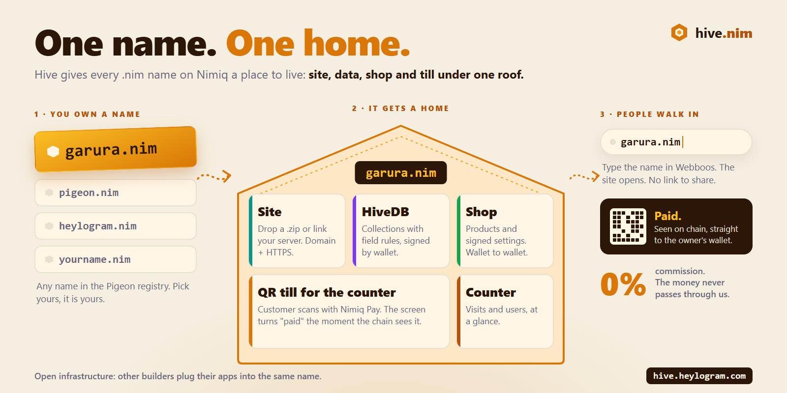
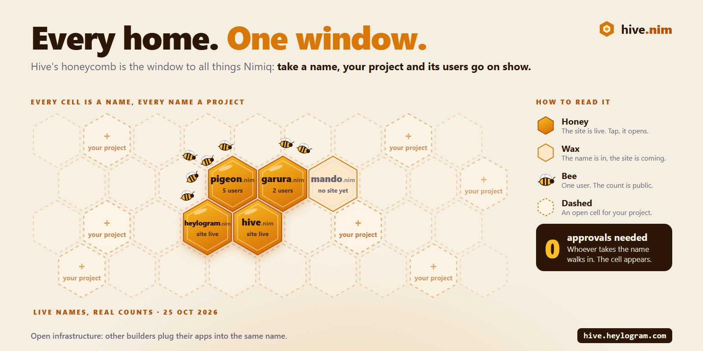

# Pigeon

Pay anyone on Nimiq by name. A Nimiq Pay mini app with `.nim` names, payment requests and bill splitting.

Live: <https://pigeon.heylogram.com> (open it in Nimiq Pay). Hosted on the Heylogram site platform; the server runs at `signal.heylogram.tv/pigeonapi`.

Nimiq has no names of its own: an address is 36 characters. Pigeon adds the missing name layer on top of Nimiq (a registry read from chain notes, no smart contract) and an [SDK](sdk/README.md) so any Mini App can resolve names and pay by name.

**Update, October 2026: Hive.** Pigeon's biggest update so far gives every name a home: a site, a database, a shop and a QR till, and a hive where every Nimiq project is on show with its users. Hive's code is in [`hive/`](hive/README.md).





Live numbers: <https://signal.heylogram.tv/pigeonapi/api/stats> (names, requests, paid requests, distinct payers).

Videos: [first release](https://youtu.be/gAgeB7Ck_w8) · [every name gets a home](https://youtu.be/vo6qgR4q9zA). What changed and when: [CHANGELOG.md](CHANGELOG.md).

Money is a letter. You write `mert.nim`, seal it, and the pigeon flies to the right address. Every person shows up with their Nimiq Identicon, so you can see that the pigeon really belongs to them.

## What it does

- **Send by name.** Type `mert.nim` or an `NQ…` address. The app shows the address and its Identicon and says whether the name matches.
- **Request.** Tie a note to the pigeon's leg (amount and reason) and share the link. When the other person pays, the request turns into "paid" by itself.
- **Split.** Tear a bill into stamps, one per person. Each stamp gets a postmark when that person pays.
- **Get a ring.** Register your own `.nim` name, on chain, with one payment.
- **Sub-rings.** The owner of `pigeon.nim` can give `cafe.pigeon.nim` to any address, or open sub-names so that players claim their own.
- **SDK for other apps.** Any website, game or Nimiq Pay mini app can resolve names, show them, log users in and pay by name. See [`sdk/`](sdk/README.md).
- **A home for every name.** Every `.nim` name gets a cell in [Hive](https://hive.heylogram.com): a site with its own domain, a database, a shop and a QR till for the counter. Pigeon's home screen opens your cell. See [Hive](#hive-a-home-for-every-name).
- **Fake link warning.** If a request claims to come from `mert.nim` but the money would go to another address, the app blocks the payment and shows both pigeons side by side.

Everything happens with real NIM on Nimiq mainnet, through the Nimiq Pay wallet. The app never holds keys or funds.

**Cost.** Using Pigeon is free and takes no fee on payments. Registering a name is a one-time payment (5 or more letters: 50 NIM, 4: 200, 3: 500, 2: 1000), with no yearly rent; the gift code `HIVE80` gives the first 80 builders a free name until 11 November 2026.

**Tokens.** Pigeon pays in NIM, which meets the Cycle III rule ("USDT, NIM, or both"). USDT by name is planned: today a Mini App needs POL for gas to send USDT on Polygon, and USDT payments in Nimiq Pay were under maintenance on 25 October 2026.

## How `.nim` names work

Nimiq has no smart contracts, so the name registry is a set of public rules applied to ordinary transactions. Anyone can rebuild the exact same table from the chain.

A registration is a transaction that:

1. goes to the registry address,
2. carries the note `nim:<name>` (lowercase letters, digits and single dashes, up to 32 characters),
3. pays at least the price of that name,
4. is included in a block and executed successfully.

If the payment comes from a wallet vault (an HTLC contract, which is how Nimiq Pay holds spendable funds), the name goes to the address that created that vault, which is the wallet's own top-up address. A vault cannot receive later payments, so this keeps every name payable. Anyone can check it: the vault's creation transaction is public.

The earliest valid registration of a name wins: lower block height first, and inside the same block the lower transaction hash. Later payments for a name that is already taken do not change its owner. The first name an address registers is its primary name, used to show who you are.

Prices depend on length: shorter names cost more. A few names such as `nim`, `nimiq`, `admin` and `wallet` are reserved. The exact list and prices are in `server/config.example.json` and `server/rules.mjs`.

### Sub-names

A sub-name has one level, like `cafe.pigeon.nim`. It is a 1 luna transaction to the registry:

- `alt:cafe.pigeon:<address>`: the owner of `pigeon.nim` gives `cafe.pigeon.nim` to an address (or to themselves without an address).
- `altac:pigeon` / `altkapa:pigeon`: the owner opens or closes sub-names. While they are open, anyone can send `alt:<sub>.pigeon` and take that sub-name for their own wallet.

Only transactions from the parent's current owner count for giving, opening and closing. A sub-name given by someone else never becomes the recipient's primary name.

### Gifts

The registry itself can hand out names. It can send `nim:<name>` to an address to gift one name, or announce a campaign with `hediye:<fingerprint>:<count>:<YYYYMMDD>`, where the fingerprint is the first 16 hex digits of SHA-256 of a code. During a campaign anyone can send any amount with `nim:<name>:<code>`. If the code matches, slots are left and the name has at least 5 letters, the name is free. The first N people win, and each address gets at most one gift per campaign.

## How payments are matched

A request has a short id. The payer's wallet sends the payment with the note `ode:<id> <reason>`. The server reads the recipient's transactions on chain and counts every included payment whose note starts with that tag. Nobody has to report a payment, and the server cannot invent one.

## Security

- **No custody.** The app only asks Nimiq Pay to send a transaction. The user confirms every payment in the wallet.
- **Chain is the source of truth.** Names and paid requests are read from the Nimiq chain with the official `@nimiq/core` light client. The server is only an index; anyone can verify it.
- **Identicons.** Each address has a unique picture. The app shows it everywhere, so a lookalike name or a swapped address is easy to notice.
- **Fake request check.** A request can say which name it comes from. If that name belongs to a different address, the app refuses to pay.
- **Notes are public.** Notes are written on chain, and the app says so before you send.
- **Server limits.** The server validates every input, caps body size and rate limits requests.

## Run it

```bash
cd server
npm install
cp config.example.json config.json
npm test
npm start
```

The web app is plain HTML, CSS and JavaScript in `web/`. `web/build.mjs` bundles everything (including the Identicons and the QR code library) into one `web/dist/index.html` next to the icons and the manifest. Build it before starting the server, which serves `web/dist`:

```bash
cd web
npm install
npm run build
```

Set `registry` in `config.json` to the address that receives name registrations. Without it, the app still sends, requests and splits, and the ring screen says the registry opens soon. The server connects to Nimiq mainnet as a light client. The first sync takes a few seconds, and the API answers `503 syncing` until then.

Then open `http://127.0.0.1:5290` in a browser to look around. Sending needs Nimiq Pay.

## API

| Method | Path | Returns |
|---|---|---|
| GET | `/api/registry` | registry address, prices, number of names, chain head |
| GET | `/api/stats` | public usage: names, owners, requests, paid requests, splits, distinct payers, NIM paid |
| GET | `/api/names` | all registered names, with their sub-name owners |
| GET | `/api/name/:name` | owner address, or `free` with price, `reserved`, `invalid` |
| GET | `/api/address/:address` | primary name of an address |
| GET | `/api/balance/:address` | balance in luna |
| GET | `/api/vaults/:address` | balance plus the Nimiq Pay vaults this address created (computed in the background; `pending` until ready) |
| GET | `/api/subs/:name` | sub-names under a name and whether they are open |
| GET | `/api/gift` | whether a gift campaign is open |
| GET | `/api/gift/:code` | slots left and last day for a code (the code itself is never stored) |
| GET | `/api/incoming/:address?since=<height>` | incoming payments with notes and sender names |
| POST | `/api/request` | create a request `{ to, value, note, as }` |
| GET | `/api/request/:id` | request with on-chain payments and status |
| POST | `/api/split` | create a split `{ to, value, people, includeMe, note }` |
| GET | `/api/split/:id` | split with every part's status |

Amounts are in luna (1 NIM = 100,000 luna).

The note words come from Turkish: `alt` = sub-name, `altac` / `altkapa` = open / close sub-names, `hediye` = gift, `ode` = pay. They stay as they are because names already registered on chain use them.

## Hive: a home for every name

A name is more useful when something lives at it. [Hive](https://hive.heylogram.com) shows every name from this registry as a cell in a hive, and the owner signs in with the same wallet:

- **Site and domain.** Upload a built site as a `.zip`, or link a site on your own server. Connect a domain you bought; the certificate comes by itself.
- **Database with server-side rules.** Every name has its own document database. Players sign in by signature and write only their own document; field rules (type, min, max, length, "only goes up", "locked", time limits) are checked on the server.
- **Sell, tip and get paid at the counter.** Products are listed in signed settings and paid wallet to wallet; Hive marks an order paid when it sees the payment on chain. The QR till makes a one-time `nimiq:` code for a sale. Nimiq Pay drops the note of a scanned code, so each open sale gets a unique amount (12 NIM becomes 12.00387) and is matched by that exact amount on chain. Money never passes through Hive.
- **Sub-names live in the cell.** `lale.garura.nim` shows inside garura's cell, and a player who has both an own name and a sub-name picks which one an app shows.

- **On a computer too.** Mini Apps are made for Nimiq Pay on a phone, but they also run in a desktop browser:
  - **Heylogram Wallet** ([Chrome extension](https://chromewebstore.google.com/detail/heylogram-wallet/khfghhlakeijakdnjkdicmfplhmgoedj)). When there is no Nimiq Pay, it provides the same wallet interface Mini Apps use (`window.nimiq`: accounts, sign, send), so a Mini App or a site using the SDK can sign in, sign and pay from a computer. Every signature and payment is confirmed in the extension.
  - **Webboos** ([desktop browser](https://webboos.heylogram.com)). Once a name has a site in Hive (uploaded or linked), type the name in the address bar, for example `garura.nim`, and the site opens under that name, with no domain to buy. The Heylogram Wallet comes built in.

The same [SDK](sdk/README.md) drives it (`hive-db.js`, `nim.js`). Coding agents can read the full API in [AGENTS.md](AGENTS.md). A test game that uses every feature runs at <https://signal.heylogram.tv/kovanapi/s/garura/>.

## Roadmap

Pigeon keeps growing after the competition. The first three updates have dates; the larger pieces open as more people use names, so each one arrives when it is needed.

**November 2026: Pay at the shop**
- Spanish, next to English and Turkish.
- Profiles: a display name and a short line on every name.

**December 2026: Names that move**
- Transfer a name to another address, or list it for sale at a price.
- Fair registration: commit and reveal, so a pending registration cannot be copied, and automatic refunds for losing payments.

**January 2027: Money together**
- Community jar: a group collects for a shared goal and everyone sees who paid.
- Repeating requests for monthly dues or a shared rent.

**Done early (October 2026)**
- Sub-names such as `cafe.pigeon.nim`, given by the owner of the parent name or claimed by players when the owner opens them.
- The open library: the [SDK](sdk/README.md) lets any Nimiq app turn `mert.nim` into an address with the same rules, log users in and pay by name.
- Pay at the shop: the QR till in Hive (tested with a real payment on mainnet), plus shops, tips and a home for every name.

**Long term: the neighbourhood fund**
People who live together pay into one transparent fund for something they need, a repair, a bridge, a playground. Offers are public, the best value wins, and the money is held in a Nimiq contract and released when the work is done. One name, one voice. No debt, no middlemen, everything on chain.

## Built with

[@nimiq/core](https://github.com/nimiq/core-rs-albatross) (Apache-2.0), [@nimiq/identicons](https://github.com/nimiq/identicons) (ISC) and the Nimiq Pay mini app provider. No framework: plain HTML, CSS and JavaScript, bundled with esbuild for hosting. QR codes by [qrcode-generator](https://github.com/kazuhikoarase/qrcode-generator) (MIT).

## License

MIT
